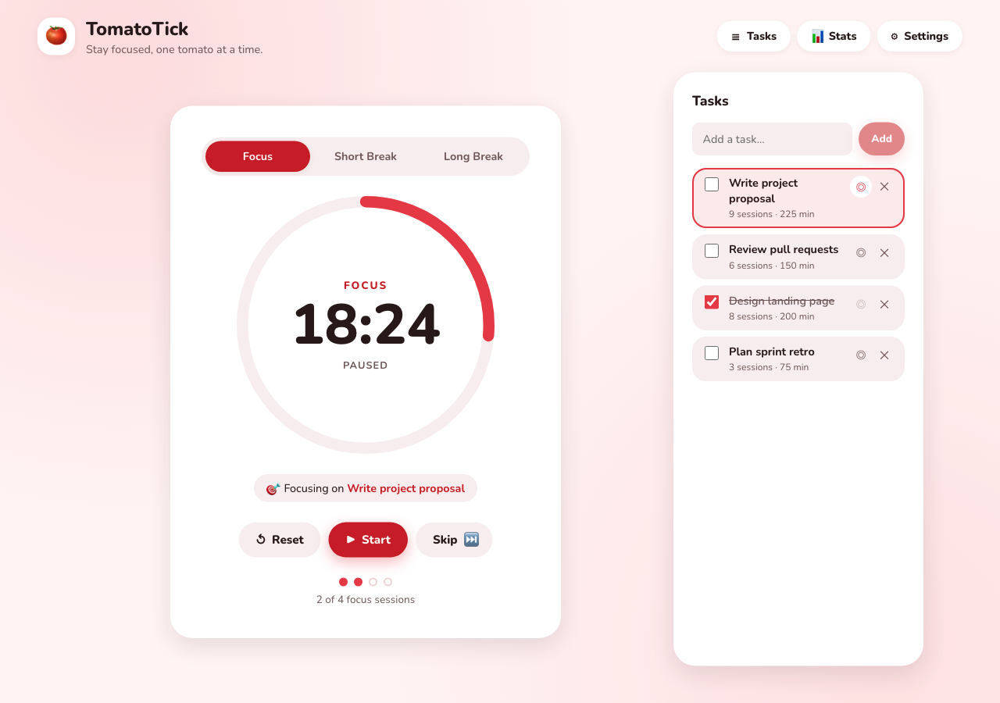
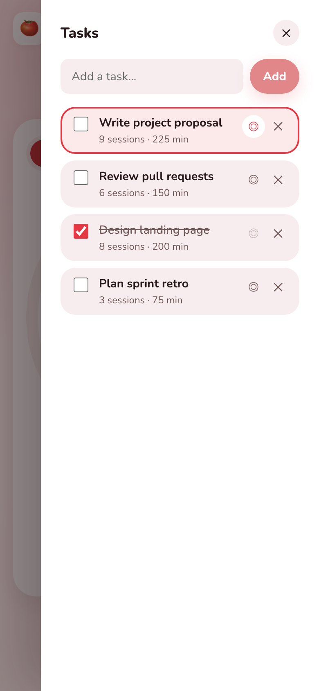
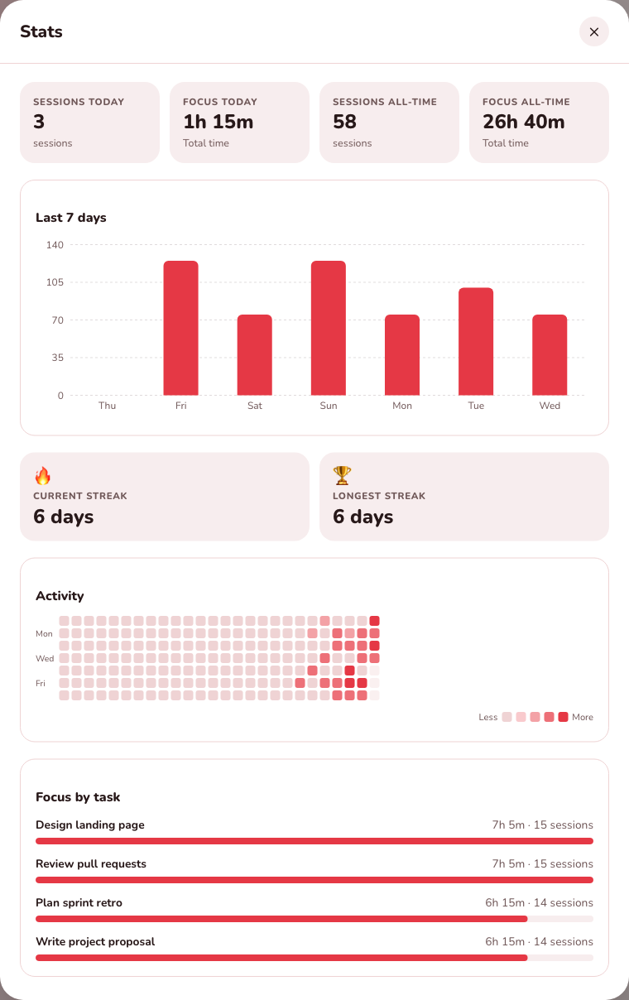

# TomatoTick 🍅

**A cheerful Pomodoro timer that helps you stay focused, one tomato at a time.**

[](https://github.com/marcoasegurado/TomatoTick/actions/workflows/ci.yml)
[](LICENSE)

**[Try TomatoTick live →](https://tomatotick.marcoeduardo-asegurado.workers.dev/)**

TomatoTick is a browser-based Pomodoro timer that combines configurable focus
and break sessions with task tracking, session history, and lightweight
productivity stats. It runs entirely in your browser and needs no account or
backend.

## Screenshots



| Task list | Statistics |
| --- | --- |
|  |  |

## Features

- **Pomodoro timer** with focus, short break, and long break modes.
- **Configurable sessions** for focus length, break lengths, and the number of
  focus sessions between long breaks.
- **Accurate, timestamp-based countdown** that stays correct in background tabs
  and resumes after a refresh or closed tab.
- **Live timer in the tab title** so you can see the remaining time from any
  browser tab.
- **Richer task management** for adding, editing, completing, deleting, and
  selecting the task you are currently working on.
  - Priorities (low, medium, high) with visible badges and priority sorting
  - Optional tags with tag filtering
  - Optional Pomodoro estimates with completed-versus-estimated progress
  - Filters for all, active, and completed tasks
  - Inline editing with validation, cancel support, and a pinned current focus
- **Session history and statistics**, including:
  - Sessions and focus time today and all-time
  - Last-seven-days focus chart
  - Current and longest streaks
  - GitHub-style activity heatmap
  - Focus time grouped by task
- **Audio alerts** with bell, chime, beep, marimba, and digital options plus
  volume control.
- **Browser notifications** when sessions end, delivered through the service
  worker when available with a Notification fallback, and a Test notification
  button in Settings.
- **Auto-start** for the next session.
- **Keyboard shortcuts** for starting, resetting, and skipping sessions.
- **Data backup** with JSON export and import, so local tasks, settings, and
  session history can be moved or restored.
- **Persistent browser storage** so the timer, settings, tasks, and session
  history survive page refreshes.
- **Installable PWA** with a web app manifest and install button on supported
  browsers.
- **Offline support** through a service worker that caches the app shell and
  assets after the first visit.
- **Responsive interface** with accessible labels, live timer status, and
  keyboard-friendly controls.
- **Six appearance choices**: System, Light, Dark, Sunset, Forest, and Midnight,
  with System following your device appearance.
- **Flexible analytics** with 7-day, 30-day, monthly, all-time, and custom ranges,
  plus CSV reports of the sessions you select.

## Tech stack

- React 19 with TypeScript
- Vite
- Recharts
- Web App Manifest and service worker for PWA/offline support
- Vitest and Testing Library
- GitHub Actions for CI
- Cloudflare for hosting

## Getting started

### Prerequisites

- Node.js 18 or newer
- npm

### Installation

```bash
git clone https://github.com/marcoasegurado/TomatoTick.git
cd TomatoTick
npm install
```

### Start the development server

```bash
npm run dev
```

Open the local URL printed by Vite, usually
`http://localhost:5173`.

### Create a production build

```bash
npm run build
```

To preview the production build locally:

```bash
npm run preview
```

## Available scripts

| Command | Description |
| --- | --- |
| `npm run dev` | Start the Vite development server |
| `npm run build` | Type-check and create a production build |
| `npm run preview` | Serve the production build locally |
| `npm test` | Run the test suite once |
| `npm run test:watch` | Run Vitest in watch mode |

## How to use

1. Start the default 25-minute focus session with the play button.
2. Open **Tasks** to add a task and mark it as the current focus.
3. Use the pencil button to edit a task's title, priority, tags, and optional
   session estimate. Use the filter buttons and tag selector to focus on the
   tasks you want to see; the selected focus task stays pinned when a filter
   hides it.
4. Use **Settings** to adjust timer durations, break intervals, alerts,
   auto-start behavior, and the app theme.
5. When a focus session completes, TomatoTick records it in your history and
   credits the selected task.
6. Open **Stats** to review your focus time, streaks, activity, and task
   breakdown.

### Stats ranges and reports

The Stats modal opens on the **7 days** range. Use the range buttons to switch
to **30 days**, **this month**, **all time**, or a **custom** start and end
date. Your choice is remembered on this device.

The summary cards, focus chart, trends, and per-task breakdown follow the
chosen range. Ranges longer than 31 days group the chart into 7-day blocks. The
activity calendar and the streak cards stay all-time, so they are labelled to
show they ignore the range.

**Export CSV** downloads a report of the sessions in the current range with the
completion date, time, task, and minutes. The JSON backup in Settings is
unaffected.

The timer supports the standard Pomodoro cycle: after the configured number of
focus sessions, it switches to a long break; otherwise, it switches to a short
break.

## Keyboard shortcuts

| Key | Action |
| --- | --- |
| `Space` | Start or pause the current session |
| `R` | Reset the current session |
| `S` | Skip to the next session |

Shortcuts are ignored while you are typing in an input. They are also listed in
the Settings modal.

## Install and offline use

On browsers that support installing web apps, an **Install** button appears in
the header when the app is installable. Installed copies open in their own
window and use the same local data as the browser tab.

After the first successful visit, a service worker caches the app shell and
Vite assets. TomatoTick then opens from the cache when you are offline, and the
timer, tasks, settings, and stats continue to work from `localStorage`. Clearing
site data or disabling the service worker removes the offline cache.

## Data and privacy

TomatoTick is a client-side application. It does not require an account or a
backend. The following data is stored in the browser's `localStorage`:

- Timer state
- Timer settings
- Tasks and task progress
- Completed focus sessions

Clearing the site's browser data resets the app and removes this local history.
Browser notifications are optional and require permission from the browser. Use
**Settings → Alerts → Send test notification** to verify that notifications
work in your browser.

Use **Settings → Data** to download a JSON backup or restore one. Backups
include your settings, tasks, and session history, but not the live timer
state. Importing replaces the current data after confirmation, so export first
if you want to keep it.

## Project structure

```text
docs/
└── screenshots/  Screenshots used in this README
public/
├── icons/        Installable PWA icons
├── favicon.svg   Browser favicon
├── manifest.webmanifest  Web app manifest
└── sw.js         Offline service worker
src/
├── components/   UI components for the timer, tasks, settings, and stats
├── context/      React context providers for settings, tasks, and sessions
├── hooks/        Timer, keyboard-shortcut, and install-prompt hooks
├── utils/        Timer, storage, formatting, alert, PWA, theme, and stats logic
├── App.tsx       Application shell and modal state
└── main.tsx      React entry point, theme setup, and service-worker registration
```

The timer and data transformations are kept in `src/utils/` so they can be
tested independently of the UI. The app uses React context providers to share
settings, task state, and completed sessions across components.

## Testing

Run all tests with:

```bash
npm test
```

The suite covers timer behavior, settings validation, task editing,
priorities, tags, estimates, filtering, sorting, backups and migration, session
statistics, range filtering and comparisons, CSV reports, time formatting, PWA
helper behavior, notification fallbacks, theme resolution and switching, dialog
focus management, and the main application flow. GitHub Actions runs the tests
and a production build on every push and pull request.

## Deploying to Cloudflare Pages

TomatoTick is a static single-page app, so it deploys to Cloudflare Pages with
no server-side configuration. The deployment is set up in the Cloudflare
dashboard:

1. Go to **Workers & Pages** and create a **Pages** project.
2. Connect the GitHub repository for this project.
3. Use these build settings:

| Setting | Value |
| --- | --- |
| Framework preset | Vite |
| Build command | `npm run build` |
| Build output directory | `dist` |
| Production branch | `main` |

Every push to `main` publishes the live site, and Cloudflare creates preview
deployments for other branches. The Vite `base` option stays at `/` because
Cloudflare Pages serves the app from the site root.

## Roadmap

The roadmap for TomatoTick includes:

- **Accessibility and mobile refinements** based on continued testing across
  browsers, screen readers, and small screens.
- **Optional synchronization** for users who want their data available across
  multiple devices.

The roadmap is subject to change as the app evolves. Planned features are not
currently part of the production behavior described above.

## License

This project is licensed under the [MIT License](LICENSE).
